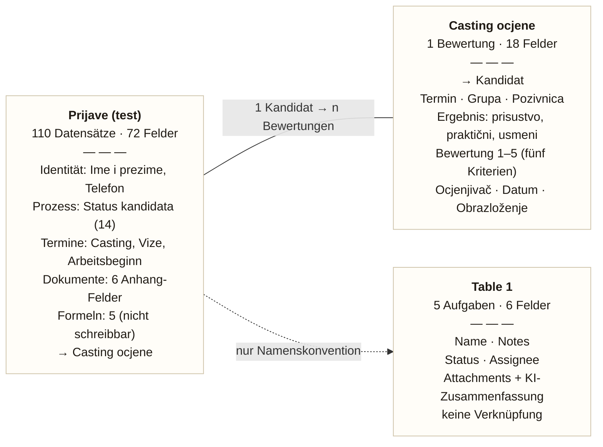

# Datenmodell Airtable — Ilvana i Hase

Aus dem Live-Schema erzeugt (`GET /schema?base=kopieren`), Stand 29.10.2026.
Dargestellt als Karten statt klassischer ER-Notation: jede Tabelle eine Karte, Relationen als Listeneintrag
und als Linie.

Base: `Ilvana i Hase (Kopieren)` · `appz3VFomHaWhuILV`
Die Base `Ilvana i Hase` hat dieselbe Struktur; sie ist noch nicht im Airtable-Token freigegeben.

## Karte 1 — Prijave (test)

`tbl7WHRtBkRX7tGxt` · 110 Datensätze · 72 Felder · 60 schreibbar

| Gruppe | Felder |
|---|---|
| Identität | `Ime i prezime`, `Ime`, `Prezime`, `Pozivni broj` + `Broj telefona`, `Kundennummer`, `Br. pasoša` |
| Prozess | `Status kandidata` (14 Stufen), `Casting grupa`, `Casting ishod`, `Ugovor tok`, `Viza ishod`, `Razlog izlaza` |
| Termine | `Termin casting`, `Termin vize`, `Datum početka rada`, `Rok akcije` |
| Dokumente | `Lebenslauf`, `Reisepass`, `Führerschein`, `Zeugnisse`, `Foto`, `Sonstige Dokumente` |
| Relation | → **Casting ocjene** über das Feld `Casting ocjene` |
| Formeln (nicht schreibbar) | `Obrazovanje (norm.)`, `Njemački (samoprocjena)`, `Vozačka (kategoria)`, `Test oznaka (po imenu)`, `Lični podaci – nedostaje` |

## Karte 2 — Casting ocjene

`tblN6vBVS7z2rj2a4` · 1 Bewertung · 18 Felder · 17 schreibbar

| Gruppe | Felder |
|---|---|
| Relation | → **Prijave (test)** über `Kandidat` (Gegenstück zu `Casting ocjene`) |
| Termin | `Termin casting`, `Grupa`, `Pozivnica`, `Potvrda dolaska` |
| Ergebnis | `Stvarno prisustvo`, `Praktični dio`, `Usmeni dio` |
| Bewertung 1–5 | `Stručnost`, `Sigurnost na radu`, `Motivacija`, `Sporazumijevanje`, `Timski rad` |
| Kontext | `Ocjenjivač`, `Datum ocjene`, `Obrazloženje`, `Izvor podatka` |
| Oznaka | `Oznaka` — Kandidatenname + Datum |

## Karte 3 — Table 1 (Aufgaben)

`tblMTxAh92crqggAY` · 5 Aufgaben · 6 Felder · 3 schreibbar

| Gruppe | Felder |
|---|---|
| Inhalt | `Name` (z. B. „Emrah Dzafic — Einladung + Termin bestätigen"), `Notes` |
| Steuerung | `Status` (Todo · In progress · Done), `Assignee` |
| Dateien | `Attachments`, `Attachment Summary` (KI-Feld, automatisch) |
| **Keine Verknüpfung** | kein Link zu Prijave — Zuordnung nur über den Namen im Titel |

## Verbindungen

| Von | Nach | Art |
|---|---|---|
| Prijave (test) | Casting ocjene | echte Verknüpfung, beidseitig (`Casting ocjene` ↔ `Kandidat`) |
| Prijave (test) | Table 1 | **nur Konvention** — Kandidatenname im Aufgabentitel, kein Datenbank-Link |

Ein Kandidat hat beliebig viele Bewertungen (pro Casting-Termin eine). Aufgaben entstehen aus den
Automatik-Regeln und werden über den Namen zugeordnet — das ist die einzige weiche Kante im Modell.

## Diagramm



## Aktualisieren

```bash
CODEWORDS_API_KEY=... python3 scripts/sync_airtable_schema.py
```

Das Skript liest das Live-Schema und schreibt `docs/airtable-schema.md` neu (alle Felder, IDs, Auswahlwerte).
Die Zählungen oben stammen aus `POST /tools/data_health`.
